


<a href="https://docs.python.org/3/"></a>
<a href="https://fastapi.tiangolo.com/"></a>
<a href="https://www.postgresql.org/docs/"></a>
<a href="https://docs.pytest.org/"></a>
<a href="https://docs.docker.com/"></a>
<a href="https://docs.github.com/actions"></a>
<a href="https://kafka.apache.org/documentation/"></a>

<a href="https://opentelemetry.io/docs/"></a>
<a href="https://kubernetes.io/docs/"></a>
<a href="https://grafana.com/docs/"></a>
<a href="https://scikit-learn.org/stable/"></a>

## About
CS student, Applied Informatics in Economics. Learning Python and backend development, building projects for finance: payments, accounting, scoring.

## Contact

